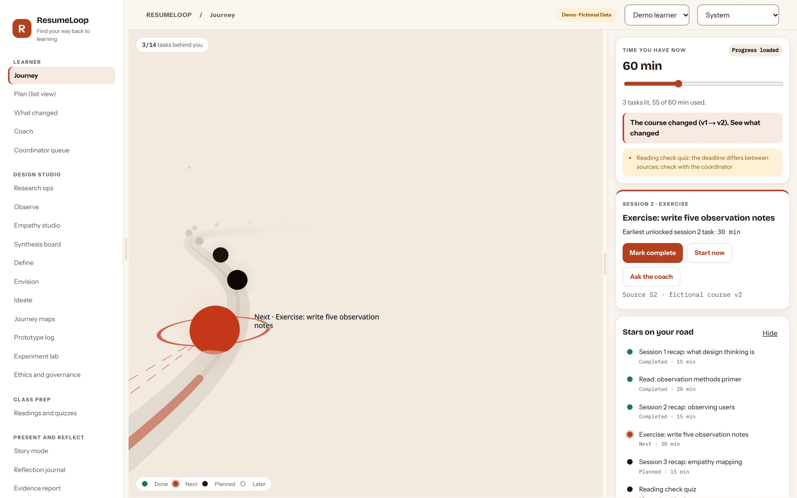
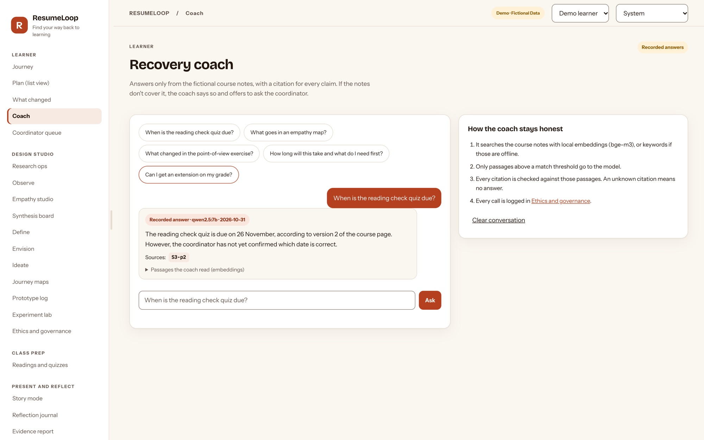
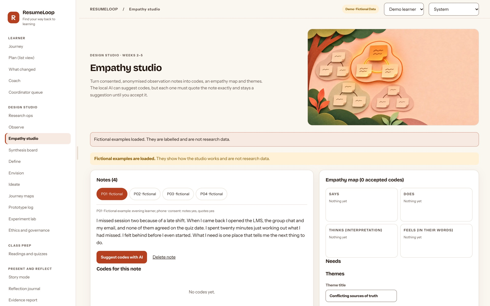
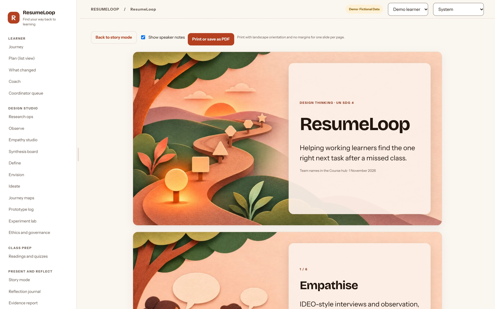
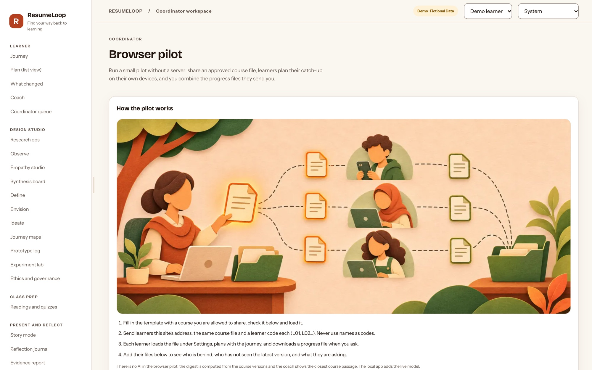
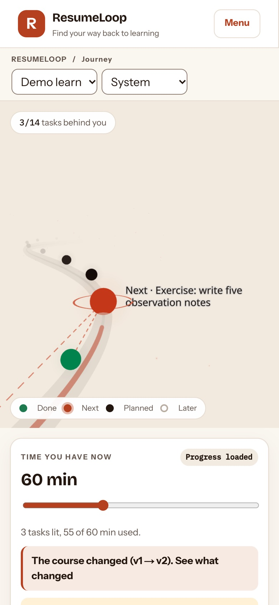
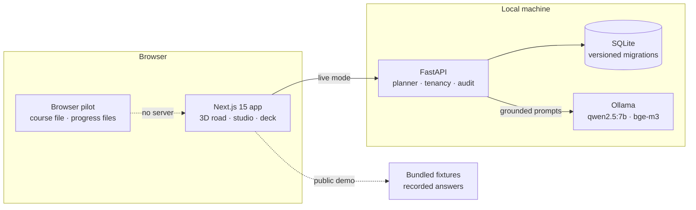

<p align="center">
  
</p>

<h1 align="center">ResumeLoop</h1>

<p align="center"><strong>Find the one right next task after a missed class.</strong><br>
A design thinking project for working learners: a 3D road of what to do next, a course-grounded AI coach that says
"I don't know", and a studio that keeps every design decision traceable to evidence.</p>

<p align="center">
  <a href="https://resumeloop-demo.vercel.app"><strong>Live demo</strong></a> ·
  <a href="submissions/">Submission pack</a> ·
  <a href="docs/FRAMEWORK.md">Framework</a> ·
  <a href="docs/FIELDWORK_SPRINT.md">Fieldwork plan</a>
</p>

<p align="center">
  <a href="https://github.com/krish2105/ResumeLoop-term-4/actions/workflows/ci.yml"></a>
</p>

---

## The problem
Working learners miss sessions. When they come back, the course has moved: tasks were added, a deadline changed, two
sources disagree. Rebuilding "what do I do now, with the 45 minutes I have?" takes effort, and some people quietly fall
behind. Persistence research treats these small breaks as moments an institution can design for (Tinto, 1975; Kara et
al., 2019).

ResumeLoop is the prototype for the MAIB **Design Thinking** unit (MGT 204). The Week 12 brief is AI-driven solutions for
the UN Sustainable Development Goals, and ResumeLoop sits under **SDG 4, Quality Education** (targets 4.3 and 4.4).

> **Status, stated plainly:** a working prototype on a fictional course. No real participants, interviews or results
> exist yet; the impact on SDG 4 is a hypothesis until the fieldwork in [`docs/FIELDWORK_SPRINT.md`](docs/FIELDWORK_SPRINT.md)
> is done. Not production software.

## See it
| Journey: your next task, lit | Coach: answers only from the course, with sources |
|---|---|
|  |  |
| **Empathy studio: code real quotes, with consent** | **Week 12 deck, built from live evidence counts** |
|  |  |
| **Browser pilot: run a real course with no server** | **Phone** |
|  |  |

## What it does
**For a returning learner**
- **Journey:** a 3D road where done tasks sit behind you and the next feasible task glows. Set the time you have; the plan
  re-orders instantly. An accessible list view and a keyboard path give the same plan without 3D.
- **What changed:** every change between course versions, computed from the data. The AI may only re-word it.
- **Coach:** asks are answered from the course notes with a citation for every claim, or politely declined with an offer to
  ask the coordinator.
- **Calendar export** of the plan, with unverified deadlines labelled as such.

**For the design team** (the course's observe → empathise → define → ideate → prototype → test)
- Research ops with consent states; live interview capture that becomes data only after consent.
- Empathy studio and synthesis board: code exact quotes, cluster themes, keep an evidence trace from theme to quote.
- Points of view, Hills, How might we, Crazy 8s, votes, and three alternatives scored, including "just fix the LMS".
- Experiment lab: freeze the protocol (SHA-256), time tasks, report medians and an exact sign test with its caveat.
- Story mode and a printable 16:9 deck for Week 12; a reflection journal that uses only your own words.

**For a coordinator**
- Import and version a course package, check it before learners see it, revert in one click.
- **Browser pilot** on the public site: share an approved course file; learners send back progress files under codes,
  never names; see who is behind and what they are asking.

## How the AI stays honest
The model only phrases and suggests; code decides what is true.

| Guard | What it does |
|---|---|
| Retrieval threshold | No passage above the similarity threshold means no answer, just an offer to ask the coordinator |
| Citation check | Every cited source must be one that was retrieved |
| Facts guard | Dates and durations in an answer must appear in the passages it cites ("twenty-five minutes" included) |
| Status guard | Words that change obligations (cancelled, optional, skip, extension, version…) need a cited passage that says so |
| Task change log | "What changed about this task?" cites a change log computed from the course versions |
| Logging | Every AI call is logged with a prompt hash, never the prompt text |

**Evaluation** on a 59-question gold set over the fictional course, live `qwen2.5:7b` + `bge-m3` via Ollama, temperature 0
and a fixed seed (two runs, identical results). Evidence: [`evidence/eval/coach-eval.json`](evidence/eval/coach-eval.json).

| Answered (of 41 answerable) | Cited the right passage | Declined out-of-scope (10) | Resisted injection (8) |
|---|---|---|---|
| **97.6%** | **97.5%** | **100%** | **100%** |

No answer among the 41 was wrong; one correct answer cites a neighbouring passage. The set is small and fictional, so read
these as engineering checks, not a claim about real learners. CI replays the recorded run offline on every push.

## Architecture

- **One codebase, two modes.** Locally the web app talks to the API and a local model; no cloud AI and no API key. The
  public Vercel build runs entirely in the browser from bundled fixtures, a TypeScript planner checked case by case against
  the Python one, and a TypeScript change diff checked against Python.
- **Deterministic planner:** excludes completed tasks, unlocks dependents, validates the prerequisite graph, and abstains
  when a duration is unknown instead of guessing.
- **Accounts (optional, `RL_AUTH=required`):** organisations and roles, every query scoped to the organisation with
  cross-tenant denial tests, scrypt passwords, hashed expiring sessions, a sign-in limit that survives restarts, audit
  log, data export and delete.

## Quality
| Check | Result |
|---|---|
| API tests (`pytest`) | 107 passing, including cross-tenant denial and the AI replay |
| Browser suite (Playwright) | 146 checks in Chromium, WebKit (Safari) and Firefox in CI |
| Browser pilot suite | 19 checks on the public build |
| Accessibility (axe, WCAG 2.2 AA) | 112 scans, 0 violations: light and dark, 320 px to 1440 px, plus touch |
| Parity | 60/60 planner cases and 7/7 change descriptions match Python |
| Security | CSP and security headers, 1 MB request limit, `pip-audit` and `npm audit` clean, [threat model](docs/SECURITY_AND_SAAS.md) |
| Load | 600 requests at concurrency 12: about 1,100 req/s, p95 18.7 ms, 0 errors |
| Containers | Docker images build and run; both run as non-root |

## Run it
Requires Python 3.14 and Node 24+ (verified on macOS arm64 with Python 3.14.7 and Node 26.10).
```bash
git clone https://github.com/krish2105/ResumeLoop-term-4.git && cd ResumeLoop-term-4
python3 -m venv .venv && .venv/bin/pip install -r services/api/requirements.lock.txt
(cd apps/web && npm ci && cp .env.example .env.local)
```
Then, in two terminals from the project root:
```bash
PYTHONPATH=services/api .venv/bin/uvicorn app.main:app --host 127.0.0.1 --port 8014
```
```bash
cd apps/web && npm run dev -- --hostname 127.0.0.1
```
Open http://127.0.0.1:3000. For the AI, install [Ollama](https://ollama.com) and run `ollama pull qwen2.5:7b` and
`ollama pull bge-m3:567m`; without it the app still works with its offline fallbacks.

- **With accounts:** `docker compose up --build`, then open http://localhost:3000/login.
- **Tests:** `PYTHONPATH=services/api .venv/bin/python -m pytest -q services/api/tests` and `cd apps/web && npm run typecheck && npm run test:parity`.
- **Full details:** [PROGRESS.md](PROGRESS.md).

## Repository map
| Path | What is there |
|---|---|
| `apps/web` | Next.js app: screens, 3D scene, demo client, browser pilot |
| `services/api` | FastAPI service, planner, AI features and guards, tests |
| `data/sample`, `data/eval` | Fictional course, studio examples, 59-question gold set |
| `docs/` | [Framework and references](docs/FRAMEWORK.md), [fieldwork sprint](docs/FIELDWORK_SPRINT.md), [assessment map](docs/ASSESSMENT.md), [security](docs/SECURITY_AND_SAAS.md), [scorecard](docs/SCORECARD.md) |
| `research/` | Study kit: consent script, interview and observation guides, templates |
| `submissions/` | Week 12 deck (.pptx), project report (.pdf), screenshots of the live site |
| `scripts/` | Evaluation, fixtures, browser and accessibility suites, load test, backup |

## Limitations
- Fictional course and data throughout; no participants, interviews or usability sessions yet.
- The 59-question evaluation is small and fictional; the 7B local model is the ceiling for answer quality.
- No hosted API, Postgres, SSO or independent security review; SQLite is not encrypted at rest.
- No screen-reader (VoiceOver/NVDA) or real-device test yet; phone checks are browser emulation.

## Credits
Built by **Krishna Mathur** for MAIB MGT 204 Design Thinking, SP Jain School of Global Management, Dubai. Illustrations
were generated with ChatGPT (OpenAI) from the prompts in [`docs/IMAGE_BRIEF.md`](docs/IMAGE_BRIEF.md); they illustrate
the process and are not research photos. References are listed in [`docs/FRAMEWORK.md`](docs/FRAMEWORK.md).
