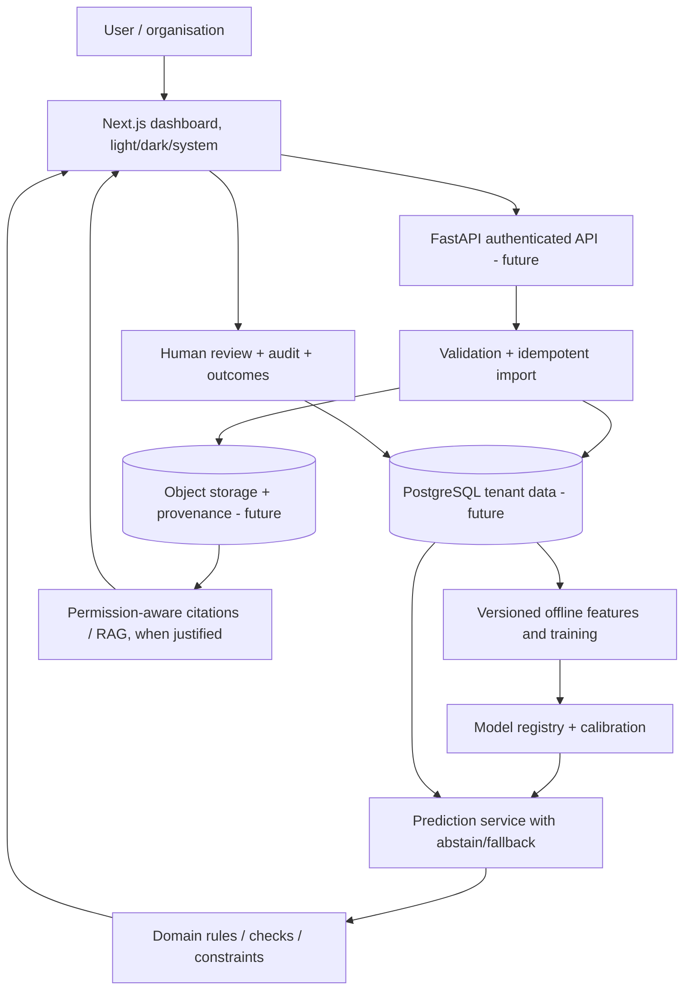

# End-to-end technical architecture — ResumeLoop

## Starter state (implemented)
- Frontend: Next.js React client pages, theme mode, interactive queue/review view, responsive CSS; fetches local API.
- Backend: FastAPI `/api/health`, `/api/demo/records`, `/api/demo/summary`, `/api/demo/domain`, `/api/demo/import`, `/api/demo/reviews`; SQLite seeded from synthetic sample.
- `services/api/app/domain.py` is a tested deterministic domain calculation, NOT an ML predictor.
- `data/sample/demo_cases.csv` contains fictional domain records. Import is a **demo-only JSON CSV text endpoint**; it is not hardened for arbitrary untrusted files.

## Production target (planned, not implemented)
- Identity: external OAuth/email auth, organisations, roles, sessions, rotation, revocation.
- Tenant isolation: PostgreSQL row-level policies plus application authorization and tests across orgs.
- Ingestion: async job queue, strict schemas, source version, idempotency, backpressure, quarantine, signed checksums.
- Source storage: immutable object versions, encryption, retention, deletion and consent.
- Training: reproducible scripts or orchestrated jobs, tracking seeds/hardware/data checksums, model lineage and approval.
- Serving: clear response schema `{prediction, uncertainty, evidence, version, status, limitations}` with conservative fallback and monitoring.
- RAG: scoped retrieval; chunk provenance; evaluation of faithfulness and retrieval quality; no unverified free-text math.
- Review engine: durable state machine (draft / queued / reviewed / approved / rejected), audit/event outbox and idempotent external actions.
- Operations: structured logs excluding sensitive data, traces, alerts, backup restore test, billing events and per-tenant quotas.

## M0 implementation update — 22 October 2026

Existing architecture retained. `app/imports.py` defines `synthetic-cases/v1`; `/api/demo/import/preview` validates without database writes. `/api/demo/import` revalidates and writes source rows plus a receipt atomically. `/api/demo/imports` lists the latest 100 receipts; `/api/demo/imports/{id}` retrieves the normalized source snapshot. SQLite `demo_imports` stores original CSV, normalized snapshot, SHA-256, schema version and receipt; unique (hash, schema) plus `BEGIN IMMEDIATE` serializes duplicate saves. Exact byte retries are no-ops, even after reviews. Different bytes are a new import; row IDs reconcile records, and existing review dispositions survive updates. These remain unauthenticated localhost synthetic-only routes.

Frontend `ImportPanel.tsx` owns draft restoration, row-level error feedback, preview, explicit save, receipt and history. Drafts use browser localStorage, are unencrypted and can be cleared by the user. Preview is invalidated on edits and after refresh. Local data is not synchronized across devices. Personal recovery plans, deadlines, coordinator messaging, authentication and multi-tenancy remain unimplemented.

## Why this architecture
Start monolithic to minimize solo-builder coordination cost. Extract services only when load, isolation or lifecycle warrants it. No vector database or agent framework until the workflow has actual relevant approved documents.

## Database entities (proposed)
`organization`, `user`, `membership`, `data_source`, `data_import`, `source_record`, `model_run`, `model_version`, `prediction`, `evidence_link`, `review_case`, `review_action`, `audit_event`, `subscription`, `usage_event`. Every customer row has tenant_id, provenance, created_at and version semantics. Sensitive fields must be minimized.
